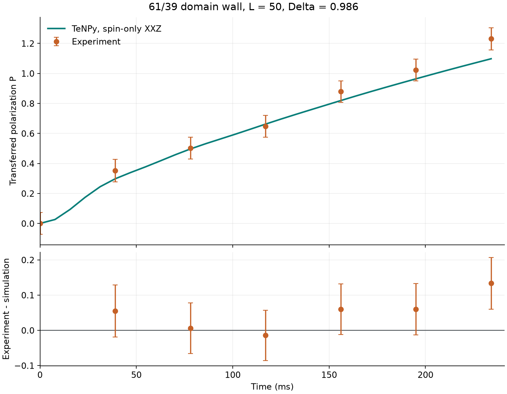

# KPZ superdiffusion in the XXZ chain with TeNPy

TeNPy simulation of spin transport across a mixed domain wall in the spin-1/2 XXZ chain, compared without fitted parameters with the quantum-gas-microscope measurements of Wei et al., *Science* 376, 716 (2022). This is an independent reproduction, not the authors' code.

## Result



| Time (ms) | Experiment P | Simulation P | Residual |
| ---: | ---: | ---: | ---: |
| 39 | 0.352 ± 0.074 | 0.298 | +0.055 |
| 78 | 0.502 ± 0.072 | 0.496 | +0.006 |
| 117 | 0.648 ± 0.072 | 0.662 | −0.014 |
| 156 | 0.879 ± 0.072 | 0.819 | +0.060 |
| 195 | 1.023 ± 0.073 | 0.964 | +0.060 |
| 234 | 1.231 ± 0.074 | 1.098 | +0.134 |

Five of six measurements lie within one experimental error; the transfer RMSE is 0.069 and the RMSE of the spin-imbalance profiles is 0.036. Halving the time step or doubling the bond dimension changes P by at most 3·10⁻⁴. The checked interval ends at 234 ms, where the χ = 512 control stops; the measurements continue to 720 ms. Profiles and the spin evolution are in [profiles.png](results/comparison/profiles.png) and [evolution.png](results/comparison/evolution.png); every number is in [summary.json](results/comparison/summary.json).

## Model and method

$$H=-J\sum_{i=1}^{L-1}\left(S_i^xS_{i+1}^x+S_i^yS_{i+1}^y+\Delta S_i^zS_{i+1}^z\right),\qquad L=50,\ \Delta=0.986,\ J/h=10.2\ \text{Hz}.$$

- Initial state: uncorrelated product state, each left site up with probability 0.61 and each right site with 0.39 (η = 0.22), as a purified MPS.
- Evolution: second-order `PurificationTEBD` with backwards disentangling, `svd_min = 1e-12`.
- Observable: transferred polarization P(t) and the change of the spin-imbalance profile on the central 46 sites, the experimental field of view.
- Spin-only model: holes, doublons, lattice ramps and imaging errors are not included.

Three numerical controls, (Δu, χ) = (0.1, 256), (0.05, 256) and (0.1, 512) with u = Jt/ħ, are compared at every sample. A time counts as converged while the halved step and the doubled bond dimension change every ⟨S^z_i⟩ by less than 2·10⁻³ and P by less than 1.5·10⁻², the total magnetization drifts by less than 10⁻⁷, the edge spins move by less than 10⁻³ and the accumulated discarded weight stays below 10⁻³. Per-sample values are in [convergence.csv](results/comparison/convergence.csv). The tests check TEBD against full diagonalisation of a six-site chain for both the mixed and the pure wall.

## Reproduce

```bash
pip install -r requirements.txt
python -m pytest
python -m kpz.compare
```

`kpz.compare` rebuilds `results/comparison/` from the saved trajectories without running TEBD. To recompute the trajectories (tens of minutes each on a laptop CPU, resumable after interruption):

```bash
python -m kpz.run baseline --target-u 15
python -m kpz.run dt --target-u 15
python -m kpz.run chi --target-u 15
```

## Layout

| Path | Content |
| --- | --- |
| `kpz/xxz.py` | model, initial wall, TEBD engine, measurements, exact diagonalisation |
| `kpz/run.py` | resumable evolution of one numerical control |
| `kpz/controls.py` | control settings, trajectory files, convergence gates |
| `kpz/compare.py` | comparison with the measurements, figures and tables |
| `data/` | the two files of the published dataset used here |
| `results/trajectories/` | ⟨S^z_i⟩(t) of the three controls |
| `results/comparison/` | figures, CSV tables and `summary.json` |
| `tests/` | exact-diagonalisation, resume and regression tests |

## Data

`data/8AC_pol-transfer.json` (Fig. S8) and `data/4A_experiment-unmagnetized.json` (Fig. 4A) are unmodified files from the dataset of Wei et al., version 1.0, [doi:10.17617/3.8W](https://doi.org/10.17617/3.8W), published under [CC BY 4.0](https://creativecommons.org/licenses/by/4.0/). Cite the paper and the dataset when using them.

## References

- D. Wei et al., Quantum gas microscopy of Kardar-Parisi-Zhang superdiffusion, *Science* 376, 716–720 (2022), [doi:10.1126/science.abk2397](https://doi.org/10.1126/science.abk2397)
- J. Hauschild and F. Pollmann, Efficient numerical simulations with Tensor Networks: Tensor Network Python (TeNPy), *SciPost Phys. Lect. Notes* 5 (2018), [TeNPy](https://github.com/tenpy/tenpy)
